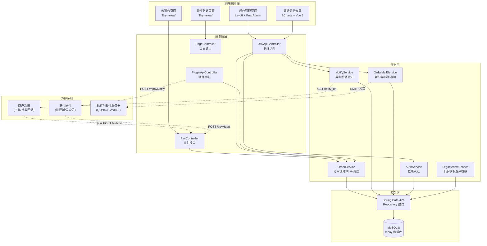
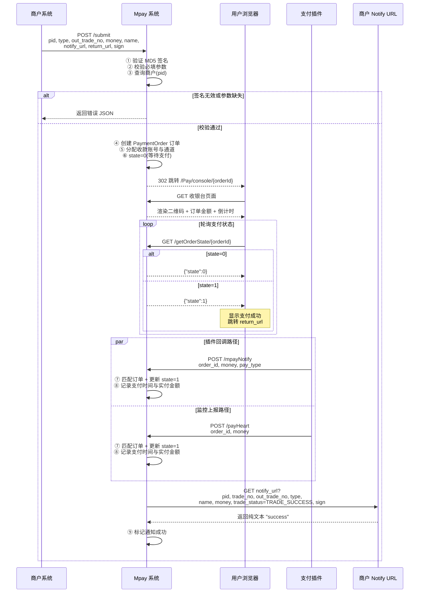
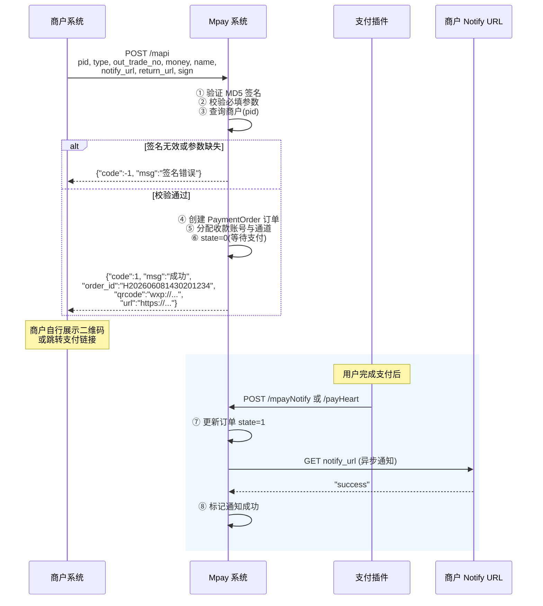
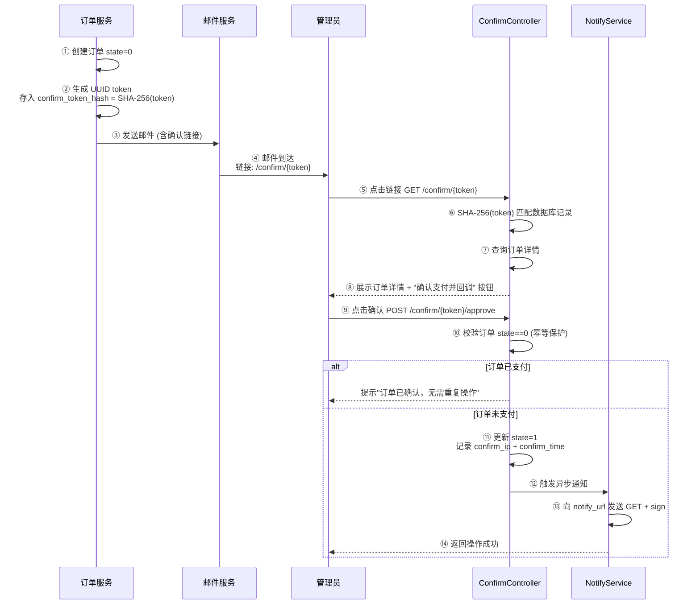
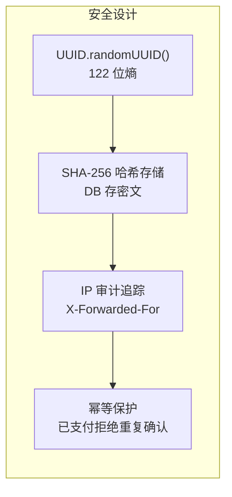
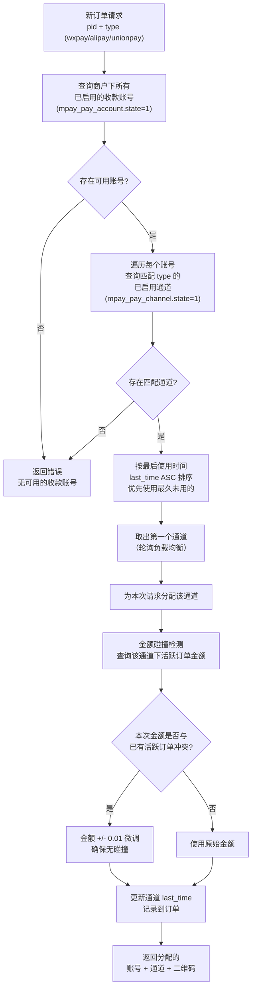
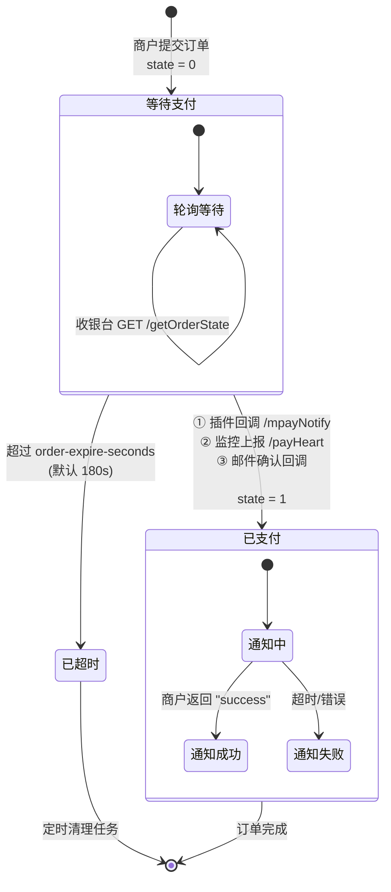
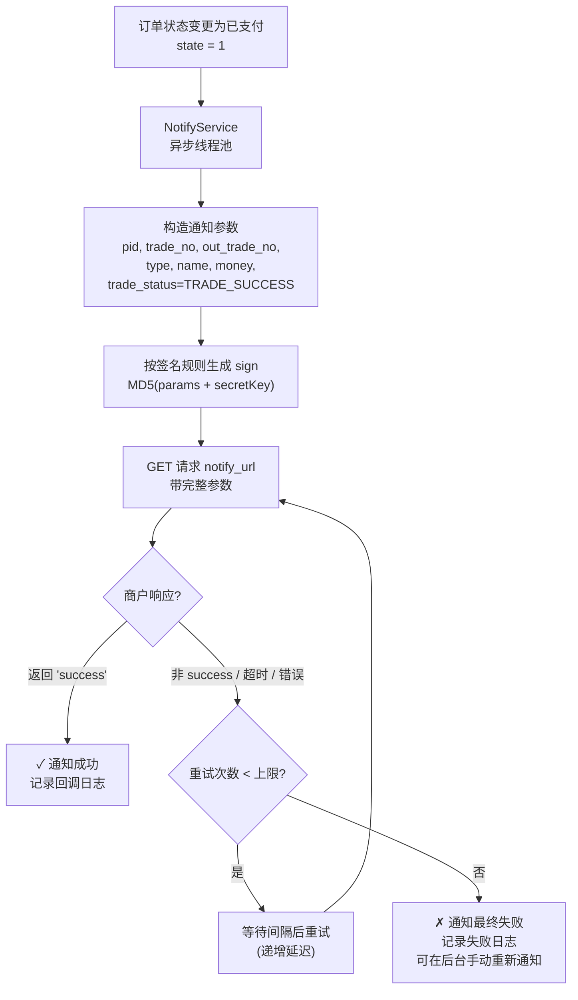
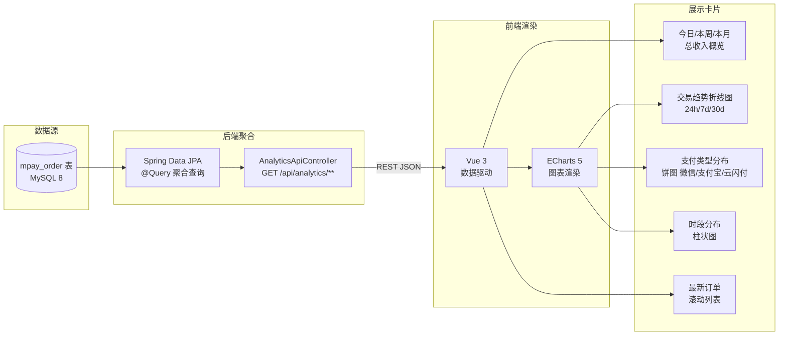

# Mpay — 聚合支付管理系统

基于 Spring Boot 3.3 的轻量级聚合支付管理系统，兼容易支付（YiPay）接口规范，支持微信、支付宝、云闪付等多渠道收款，提供订单管理、收款统计、数据分析大屏、邮件通知等完整功能。

## 技术栈

| 层次 | 技术 |
|------|------|
| 运行环境 | Java 17 |
| 核心框架 | Spring Boot 3.3.5 |
| 持久层 | Spring Data JPA + Hibernate (ddl-auto: update) |
| 数据库 | MySQL 8 |
| 模板引擎 | Thymeleaf |
| 邮件发送 | Spring Mail (JavaMailSender) |
| API 文档 | Knife4j 4.5 / OpenAPI 3 |
| 前端框架 | LayUI + PearAdmin + ECharts + Vue 3 |
| 构建工具 | Maven |

## 功能概览

### 支付接口（易支付兼容）

| 接口 | 路径 | 说明 |
|------|------|------|
| 跳转下单 | `GET/POST /submit` | 兼容 YiPay submit，302 跳转至收银台 |
| API 下单 | `GET/POST /mapi` | 兼容 YiPay mapi，返回 JSON |
| 收银台 | `GET /Pay/console/{orderId}` | 展示二维码/支付链接 + 轮询支付状态 |
| 状态轮询 | `GET /getOrderState/{orderId}` | 收银台轮询订单是否已支付 |
| 监控上报 | `POST /payHeart` | 监控端上报已收款，触发回调通知 |
| 插件通知 | `POST /mpayNotify` | 收款插件回调接口 |

### 后台管理

- **首页控制台** — 今日/昨日/本周/本月收入统计，订单总量与分渠道汇总
- **数据分析大屏** — 概览卡片、交易趋势图、支付类型分布、时段分布、最新订单列表
- **收款账号管理** — 多商户账号 + 通道配置（链接/二维码），支持启用/禁用、轮询调度
- **订单管理** — 列表筛选、手动补单、重新通知、批量删除、超时清理
- **系统设置** — 邮件提醒配置（QQ/163/Gmail/Outlook/自定义 SMTP）
- **基本资料** — 管理员信息、密钥管理

## 项目结构

```
mapy_claude/
├── pom.xml
├── database/
│   └── mpay_mysql.sql              # 数据库初始化脚本
├── src/main/java/com/mapay/
│   ├── MapayApplication.java        # Spring Boot 入口
│   ├── common/
│   │   ├── ApiResponse.java        # 统一响应格式 {code, msg, data}
│   │   └── SignUtils.java          # MD5/SHA-256 签名工具
│   ├── config/
│   │   ├── AppConfig.java          # 初始化种子数据
│   │   ├── AuthInterceptor.java    # 登录拦截器
│   │   ├── MapayProperties.java     # mpay.* 自定义配置绑定
│   │   └── WebMvcConfig.java       # 拦截器注册
│   ├── controller/
│   │   ├── AnalyticsApiController.java  # 数据分析大屏 API
│   │   ├── ConfirmController.java       # 邮件确认回调页面
│   │   ├── ConsoleApiController.java    # 后台首页 API
│   │   ├── OrderApiController.java      # 订单管理 API
│   │   ├── PageController.java          # 后台页面路由
│   │   ├── PayController.java           # 支付接口（易支付兼容）
│   │   ├── PayManageApiController.java  # 收款账号管理 API
│   │   ├── PluginApiController.java     # 插件中心 API
│   │   ├── SettingsApiController.java   # 系统设置 API
│   │   └── UserApiController.java       # 用户/登录 API
│   ├── model/
│   │   ├── MailConfig.java         # 邮件配置实体
│   │   ├── PayAccount.java         # 收款账号实体
│   │   ├── PayChannel.java         # 收款通道实体
│   │   ├── PaymentOrder.java       # 支付订单实体
│   │   └── User.java               # 商户/管理员实体
│   ├── repository/                 # Spring Data JPA 仓库
│   ├── service/
│   │   ├── AuthService.java        # 登录认证
│   │   ├── LegacyViewService.java  # 旧版 PHP 模板渲染桥接
│   │   ├── NotifyService.java      # 异步回调通知
│   │   ├── OrderMailService.java   # 新订单邮件通知
│   │   └── OrderService.java       # 订单创建/补单/调度
│   └── resources/
│       ├── application.yml         # 主配置（含 mpay 自定义属性）
│       ├── application_dev.yml     # 开发环境
│       ├── application_prod.yml    # 生产环境
│       ├── application_test.yml    # 测试环境
│       ├── static/app/             # 静态资源
│       └── templates/
│           ├── cashier.html        # 收银台页面
│           └── confirm.html        # 邮件确认回调页面
├── view/                           # 后台管理 HTML 页面
│   ├── console/                    # 首页控制台
│   ├── analytics/                  # 数据分析大屏
│   ├── order/                      # 订单管理
│   ├── pay_manage/                 # 收款账号管理
│   ├── settings/                   # 系统设置
│   └── user/                       # 个人资料
└── public/                         # 前端静态资源（LayUI/PearAdmin）
```

## 快速开始

### 环境要求

- JDK 17+
- MySQL 8.0+
- Maven 3.8+

### 数据库初始化

```sql
CREATE DATABASE mpay DEFAULT CHARACTER SET utf8mb4 COLLATE utf8mb4_unicode_ci;
```

首次启动时 JPA 会自动建表（`ddl-auto: update`），也可手动导入 `database/mpay_mysql.sql`。默认管理员账号：

| 项目 | 值 |
|------|-----|
| 用户名 | `admin` |
| 密码 | `admin123` |
| PID | `1000` |
| 角色 | `admin` |

### 配置文件

修改 `application_dev.yml` 中数据库连接信息：

```yaml
spring:
  datasource:
    url: jdbc:mysql://127.0.0.1:3306/mpay?useUnicode=true&characterEncoding=utf8&serverTimezone=Asia/Shanghai
    username: root
    password: 123456
```

### 启动

```bash
mvn spring-boot:run
# 或
mvn package -DskipTests && java -jar target/mapay-code-payment-2.0.0.jar
```

启动后访问：

| 地址 | 说明 |
|------|------|
| `http://localhost:8080` | 后台登录页 |
| `http://localhost:8080/doc.html` | API 文档（仅 dev/test 环境） |

## 配置说明

`application.yml` 中的自定义配置项：

```yaml
mpay:
  order-expire-seconds: 180    # 订单超时时间（秒），超时后自动清理
  upload-dir: ./data/uploads   # 文件上传目录
  base-url: http://localhost:8080  # 系统外网地址，用于邮件中的确认链接
```

生产环境务必修改 `base-url` 为实际域名。

## 邮件确认回调流程

管理员可以通过邮件中的链接直接确认收款并触发异步通知，无需登录后台。

### 流程

详见 [4. 邮件确认回调流程](#4-邮件确认回调流程) 的 Mermaid 时序图和安全设计流程图。

### 安全设计

- **令牌哈希存储**：数据库仅存 `SHA-256(原始Token)`，即使数据库泄露也无法伪造链接
- **UUID 随机性**：原始令牌使用 `UUID.randomUUID()`，122 位熵，不可暴力破解
- **审计追踪**：确认操作记录 IP 地址（优先取 `X-Forwarded-For`）和确认时间
- **幂等保护**：已支付订单拒绝重复确认

### 邮件配置

在后台「系统设置 → 邮件提醒」中配置 SMTP 参数，支持：

| 类型 | 默认 SMTP | 端口 | 加密 |
|------|-----------|------|------|
| QQ | smtp.qq.com | 465 | SSL |
| 163 | smtp.163.com | 465 | SSL |
| 126 | smtp.126.com | 465 | SSL |
| Gmail | smtp.gmail.com | 587 | STARTTLS |
| Outlook | smtp.office365.com | 587 | STARTTLS |
| 自定义 | 手动填写 | 手动填写 | 可选 |

### 邮件内容示例

```
有新的支付订单，请及时处理。

平台订单号：H202606081430201234
商户订单号：ORDER20260608001
商户 PID：1000
支付方式：wxpay
商品名称：测试商品
订单金额：0.01
实付金额：0.02
订单状态：0
创建时间：2026-06-08T14:30:20
关闭时间：2026-06-08T14:33:20
异步通知地址：https://merchant.example.com/notify
同步跳转地址：https://merchant.example.com/return

管理员确认链接：http://localhost:8080/confirm/a1b2c3d4e5f6...

点击此链接可查看订单详情并确认收款。确认后系统将自动回调订单。
```

## 支付接入

### 商户下单参数

| 参数 | 必填 | 说明 |
|------|------|------|
| pid | 是 | 商户 ID |
| type | 是 | 支付方式：wxpay / alipay / unionpay |
| out_trade_no | 是 | 商户订单号（唯一） |
| notify_url | 是 | 异步通知地址 |
| name | 是 | 商品名称 |
| money | 是 | 订单金额（元，最多两位小数） |
| return_url | 否 | 支付完成同步跳转地址 |
| sign | 是 | MD5 签名（参见签名规则） |

### 签名规则

1. 将所有请求参数（除 `sign`、`sign_type` 外）按参数名 ASCII 升序排序
2. 拼接为 `key1=value1&key2=value2` 格式
3. 末尾追加商户密钥（SecretKey）
4. 对整个字符串做 MD5

```java
source = "money=0.01&name=测试&notify_url=https://...&out_trade_no=ORDER01&pid=1000&type=wxpay" + secretKey
sign = MD5(source)
```

### 异步通知

订单支付成功后，系统会向 `notify_url` 发送 GET 请求，携带以下参数（同样按签名规则附带 `sign`）：

| 参数 | 说明 |
|------|------|
| pid | 商户 ID |
| trade_no | 平台订单号 |
| out_trade_no | 商户订单号 |
| type | 支付方式 |
| name | 商品名称 |
| money | 订单金额 |
| trade_status | 固定为 `TRADE_SUCCESS` |
| sign | MD5 签名 |

商户系统收到通知后返回纯文本 `success` 表示确认接收。

## 收款通道调度

系统自动为每个新订单分配可用的收款账号和通道：

1. 查找商户下所有启用的收款账号
2. 筛选匹配支付类型的已启用通道
3. 按 `最后使用时间升序` 排序，优先使用最久未使用的通道（轮询负载）
4. 同一通道的活跃订单金额自动错开 0.01 元，避免金额碰撞

> 调度流程图见 [5. 收款通道调度流程](#5-收款通道调度流程)

## 数据模型

### 核心表

| 表名 | 说明 | 关键字段 |
|------|------|----------|
| `mpay_user` | 商户/管理员 | pid, username, password(BCrypt), secret_key, role |
| `mpay_order` | 支付订单 | order_id, pid, type, money, state, confirm_token, confirm_ip |
| `mpay_pay_account` | 收款账号 | pid, platform, account, state |
| `mpay_pay_channel` | 收款通道 | account_id, channel, qrcode, type, last_time |
| `mpay_mail_config` | 邮件配置 | enabled, type, host, username, password |

### 订单状态

| state | 含义 |
|-------|------|
| 0 | 等待支付 |
| 1 | 已支付 |

## 权限控制

- 基于 Session 的登录认证（未引入 Spring Security 框架，仅使用 BCrypt 加密密码）
- `AuthInterceptor` 拦截所有非公开路径，未登录返回 401 或重定向至登录页
- 公开路径：支付接口、收银台、轮询、回调、邮件确认链接、静态资源、API 文档
- 当前版本未区分 admin/user 角色权限，后续可按需扩展

## 系统流程图

### 1. 系统整体架构



### 2. 支付核心流程 — 跳转下单 `/submit`



### 3. 支付核心流程 — API 下单 `/mapi`



### 4. 邮件确认回调流程





### 5. 收款通道调度流程



### 6. 订单状态流转



### 7. 异步通知与重试机制



### 8. 数据分析大屏数据流



## 部署

### 宝塔面板

参考 `BAOTA_DEPLOY.md`，在宝塔 Java 项目管理器中添加项目，配置域名反向代理。

### 生产环境检查清单

1. 修改 `application_prod.yml` 中数据库密码
2. 设置 `mpay.base-url` 为实际域名
3. 确认 `mpay.api-docs.enabled: false`（关闭 API 文档公网暴露）
4. 配置邮件 SMTP 并发送测试邮件
5. 修改默认管理员密码
